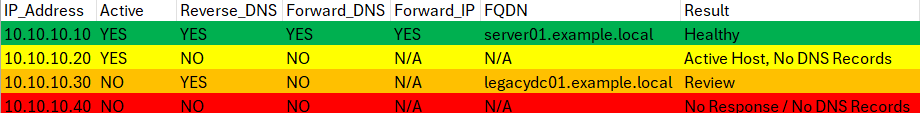
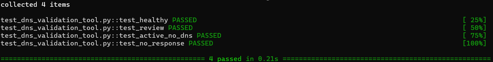
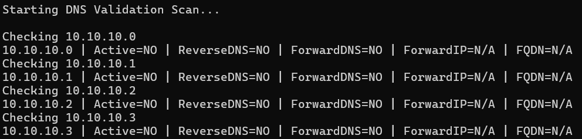

# DNS Validation Tool
Develop a Python-based infrastructure validation tool capable of:
* Identifying reachable hosts
* Performing reverse DNS validation (IP → Hostname)
* Performing forward DNS validation (Hostname → IP)
* Identifying DNS inconsistencies
* Exporting findings to CSV
* Producing actionable infrastructure reports

_The tool was developed during an enterprise subnet inventory and DNS validation initiative._

### Features
* ICMP Reachability Validation
* Reverse DNS Validation
* Forward DNS Validation
* Forward IP Verification
* CSV Reporting
* Classification-Based Results

### Methodology
The tool performs infrastructure validation through three independent checks:
1. ICMP Reachability Validation
  * Determines whether a host responds to network probes.
2. Reverse DNS Validation
  * Resolves an IP address to a hostname.
3. Forward DNS Validation
  * Resolves the hostname back to an IP address and verifies consistency.
Results from all three checks are used to classify hosts into operational categories and identify potential DNS inconsistencies.

### Classification Logic
**Result**	**Description**
Healthy	| Reachable with valid forward and reverse DNS
Review	| DNS inconsistency or additional validation required
Active Host, No DNS Records	| Reachable host without DNS records
No Response / No DNS Records | Unreachable host with no DNS records

### Automated Testing
The classification logic was validated using pytest unit tests.

Test cases included:
* Healthy
* Review
* Active Host, No DNS Records
* No Response / No DNS Records

### Sample console output

### Lessons Learned
During testing, I discovered that relying solely on reverse DNS (PTR) records could lead to inaccurate conclusions about asset status.

Initial versions of the tool only validated reverse DNS records. After manually validating results using **ping** and **nslookup**, I identified cases where reverse DNS records existed but forward DNS validation failed, creating false positives during infrastructure review.

To improve accuracy, the tool was redesigned to independently validate:
* ICMP reachability
* Reverse DNS (IP → Hostname)
* Forward DNS (Hostname → IP)

This enhancement improved reporting accuracy, reduced false assumptions, and introduced a classification methodology that clearly communicated findings to both technical and business stakeholders.
